<p align="center">
  
</p>

<p align="center"><b>English</b> · <a href="README.zh-TW.md">繁體中文</a></p>

<p align="center">
  <a href="https://github.com/xamjiang/ghosts/releases/latest"></a>
  <a href="https://github.com/xamjiang/ghosts/actions/workflows/ci.yml"></a>
  
  
  <a href="LICENSE"></a>
</p>

<h3 align="center">Install in one line</h3>

```sh
curl -fsSL https://ghosts.xamjiang.com/install | bash
```

<p align="center">Then run <code>ghosts</code> in your terminal. Works on macOS 13+ and Linux (amd64 / arm64).<br>
<sub>Adds an APT repository on Ubuntu / Debian, uses Homebrew if you have it, and downloads the binary everywhere else. <a href="#installation">Details ↓</a></sub></p>

<br>

<p align="center">
  
</p>

AI coding tools like Claude Code and Codex start dev servers and Docker services to test their work, and often leave them running. A closed terminal, a finished agent run, the `npm run dev` from two days ago: they're all still in the background, holding ports and draining your battery. **Ghosts shows you every one of these leftovers at a glance, and stops them with a single key.**

## ✨ Features

<table>
  <tr>
    <td width="40%" valign="top" rowspan="2">
      <h3>👻 Spot the real ghosts</h3>
      <p>The terminal is gone, the agent is done, but the server is still up. Ghosts marks processes that outlived their session as <b>detached</b>, and shows which project they belong to, how long they've been running and the full command that started them.</p>
      
    </td>
    <td width="60%" valign="top">
      <h3>🔋 See what's draining power</h3>
      <p>CPU and memory for every service, plus each process's actual power draw on Apple Silicon, children included. Press <kbd>s</kbd> to sort by power.</p>
      
    </td>
  </tr>
  <tr>
    <td valign="top">
      <h3>🐳 Docker included</h3>
      <p>Containers are grouped by compose project, and ports proxied by Docker Desktop map back to the real container. Stop a whole compose project at once.</p>
      
    </td>
  </tr>
</table>

### 🛑 Stops things safely


Press <kbd>x</kbd> to stop, <kbd>X</kbd> to force stop.

- Sends SIGTERM first, and only offers SIGKILL if the process is still alive after 3 seconds
- Checks the process start time before signalling, so a reused PID never takes down the wrong process
- Stops containers with `docker stop`, never by killing Docker Desktop
- Hides apps and system services by default, and warns you before stopping one

<br clear="right">

### ⚡ Light enough to leave open

| | macOS (Apple Silicon) | Linux (i7-8700) |
|---|---|---|
| One scan | ~2 ms | ~4 ms |
| CPU | ~1% | ~0.9% |
| Memory | ~15 MB | ~19 MB |
| External commands | None: reads the kernel instead of forking `lsof` | None: talks netlink instead of forking `ss` |

When the window loses focus, Ghosts scans a third as often. Docker updates arrive live over its event stream.

## Installation

The script installs Ghosts with your system's own package manager, so it updates like everything else:

| System | How it installs | Update | Uninstall |
|---|---|---|---|
| Ubuntu, Debian | Adds the ghosts APT repository, then `apt install` (asks for your sudo password) | `sudo apt update && sudo apt upgrade` | `sudo apt remove ghosts` |
| With Homebrew | `brew install xamjiang/tap/ghosts` | `brew upgrade ghosts` | `brew uninstall ghosts` |
| Anything else | Downloads the binary, verifies its checksum and installs it to `~/.local/bin` | Run the install command again | `rm ~/.local/bin/ghosts` |

Want to read the script first? It's at [ghosts.xamjiang.com/install.sh](https://ghosts.xamjiang.com/install.sh).

Prefer not to pipe to bash? Run `brew install xamjiang/tap/ghosts`, download from [Releases](https://github.com/xamjiang/ghosts/releases), or set up APT yourself:

```sh
sudo install -d -m 0755 /etc/apt/keyrings
curl -fsSL https://ghosts.xamjiang.com/apt/key.gpg | sudo tee /etc/apt/keyrings/ghosts.gpg >/dev/null
echo "deb [signed-by=/etc/apt/keyrings/ghosts.gpg] https://ghosts.xamjiang.com/apt stable main" | sudo tee /etc/apt/sources.list.d/ghosts.list
sudo apt update && sudo apt install ghosts
```

## ⌨️ Usage

### Flags

| Flag | Description |
|---|---|
| `-interval 2s` | How often to rescan ports (Docker updates live over its event stream either way) |
| `-no-mouse` | Don't capture the mouse, so the terminal's native text selection keeps working |
| `-list [-all]` | Print the list once and exit, for scripts |

### Keys

| Key | Action |
|---|---|
| `↑↓` / `j k` | Move |
| `⇥` / `1 2` | Switch between Ports and Containers |
| `⏎` | Show or hide details |
| `x` / `X` | Stop / force stop (a process, a container or a whole compose project) |
| `o` | Open in the browser |
| `/` | Filter (port, name, project, image) |
| `a` | Show apps and system services |
| `s` | Sort by port / power / memory / newest / name |
| `?` | Help |

To save even more power, use `-interval 5s`.

## 🔍 How it works

<details>
<summary>No <code>lsof</code>, no forked processes: Ghosts reads the kernel directly. Expand for the details.</summary>

This is how it works on macOS; the differences on Linux follow.

- **Ports**: instead of calling `lsof`, Ghosts reads the kernel's data directly through `sysctl` and libproc: one sysctl call for the whole process table, then the sockets of your own processes. A scan takes about 2 ms and never forks an external program. Each process's command and working directory are cached by PID.
- **Resource usage**: `proc_pid_rusage` gives each process's accumulated CPU time, memory (matching Activity Monitor's Memory column) and energy. Only Apple Silicon has the energy counter, so the POWER column is hidden on Intel Macs. Each service's numbers include its child processes, and rates are averaged over the last ~6 seconds.
- **Container resources**: CPU and memory come from Docker's one-shot stats, which take a few ms per container. A container's power can't be measured on its own, so Ghosts shows the power and memory of the whole Docker VM instead.
- **Docker**: Ghosts talks to the Docker Engine's unix socket directly (Docker Desktop, OrbStack and Colima all work) and subscribes to its event stream for live updates. Ports published by Docker map back to their containers, and stopping one runs `docker stop`, so Docker Desktop itself is never killed.
- **Stopping processes**: SIGTERM first, and SIGKILL only if you confirm after the process has had 3 seconds to exit. Before signalling, Ghosts checks the process start time, so a reused PID never hits another process.

#### On Linux

- **Ports**: netlink (sock_diag, the same mechanism `ss` uses) asks the kernel for LISTEN sockets only, which are then mapped back to processes through `/proc/<pid>/fd`. The mapping is cached and refreshed only when a new socket appears, or every 30 seconds. The process table, CPU and memory all come from `/proc/<pid>/stat`. A scan takes about 4 ms and, again, forks nothing.
- **Resource usage**: memory is RSS (matching `top`'s RES). Linux has no per-process energy counter and doesn't report per-process wakeups, so the POWER column and Wakeups are hidden.
- **Forgotten processes**: a server left behind by a closed terminal or SSH session gets adopted by PID 1 or the user's `systemd --user`. Ghosts looks at its cgroup: if it's still in its old session's `*.scope`, it's marked detached; services that systemd started on purpose (`*.service`) aren't.
- **Docker**: Ghosts follows the context `docker context` has selected, so with Docker Engine and Docker Desktop side by side it shows the same containers as `docker ps`. Docker Engine runs containers on the host with no VM, so the summary line shows the CPU and memory of all containers combined instead.
- **Opening the browser**: uses `xdg-open`. Over SSH, the URL is copied to your local clipboard with OSC 52 instead (if your terminal supports it, like iTerm2, Ghostty or kitty).

</details>

## 🛠 Development

```sh
go build -o bin/ghosts ./cmd/ghosts && ./bin/ghosts
go test ./...
```

The macOS build uses libproc and needs cgo (the Xcode Command Line Tools are enough). The Linux build doesn't, so you can cross-compile it on a Mac:

```sh
GOOS=linux GOARCH=amd64 go build -o bin/ghosts-linux ./cmd/ghosts
```

Platform-specific code lives in files named by platform: `internal/ports/*_darwin.go`, `*_linux.go` and `internal/ui/platform_*.go`.

### README screenshots

The screenshots in `docs/images/` aren't captured by hand: the real UI code renders made-up data to SVG, so they never leak the processes and paths on your machine. Regenerate them after changing the UI:

```sh
GHOSTS_SCREENSHOTS=$PWD/docs/images go test -run TestScreenshots ./internal/ui
```

<details>
<summary><b>Releasing</b>: push a tag, and the macOS / Linux binaries, <code>.deb</code> packages, APT repository and Homebrew formula all update themselves.</summary>

```sh
git tag v0.6.0 && git push origin v0.6.0
```

`.github/workflows/release.yml` then:

1. Runs the tests on macOS and Ubuntu.
2. macOS: builds a universal binary (arm64 + amd64).
3. Linux: builds amd64 and arm64, and packages them as `.deb` with `packaging/deb.sh`. The `.deb` file names carry no version (`ghosts_linux_amd64.deb`), so `releases/latest/download/…` always points at the latest one.
4. Creates the GitHub Release with every file and `checksums.txt`.
5. Generates a formula for both macOS and Linux from `packaging/ghosts.rb.tmpl` and pushes it to [xamjiang/homebrew-tap](https://github.com/xamjiang/homebrew-tap).
6. Generates and signs the APT index (`apt_InRelease`, `apt_Packages_amd64.gz`, …) with `packaging/apt-repo.sh` and attaches it to the Release next to the `.deb` files. The Release starts as a draft and is published only once every file is uploaded, so apt never sees a half-uploaded version.

Tags can carry a pre-release suffix (like `v0.2.0-rc1`). The `.deb` version becomes `0.2.0~rc1`, so apt sorts it before the final `0.2.0`.

Required GitHub secrets:

| Secret | Used for |
|---|---|
| `HOMEBREW_TAP_TOKEN` | A fine-grained token with Contents read/write on `homebrew-tap` only |
| `APT_GPG_PRIVATE_KEY` | The APT repository's signing key (ASCII armored) |
| `CLOUDFLARE_API_TOKEN` | A Cloudflare API token that can deploy Workers (used by `worker.yml`) |
| `CLOUDFLARE_ACCOUNT_ID` | The Cloudflare account ID |

#### ghosts.xamjiang.com

`worker/` is a Cloudflare Worker: `/` is the website, `/install` serves the install script (or the website, to a browser) and `/apt/` is the APT repository. The repository has no storage of its own: the index files come from the latest GitHub Release's assets, `.deb` downloads redirect to that release, and the public key (`packaging/apt-key.*`) is bundled into the Worker. That means apt only sees the latest version; older `.deb` files are on the Releases page. The install script, the website and its images are bundled into the Worker too, so `.github/workflows/worker.yml` redeploys it whenever `packaging/install.sh`, `docs/images/` or `worker/` changes on main. To try it locally:

```sh
cd worker && npx wrangler@4.137.0 dev
```

</details>

<p align="center"><sub>MIT License · Built with <a href="https://github.com/charmbracelet/bubbletea">Bubble Tea</a> · <a href="https://ghosts.xamjiang.com">ghosts.xamjiang.com</a></sub></p>
