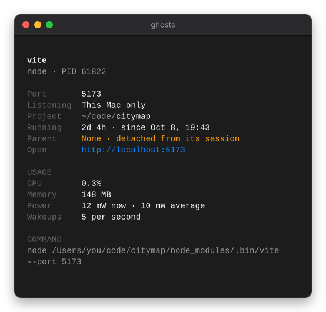
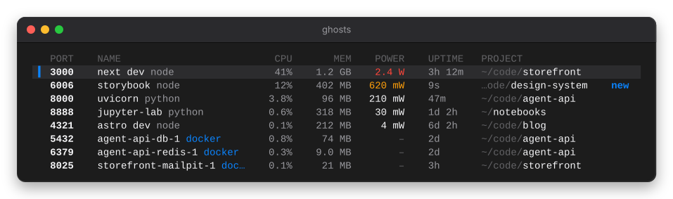
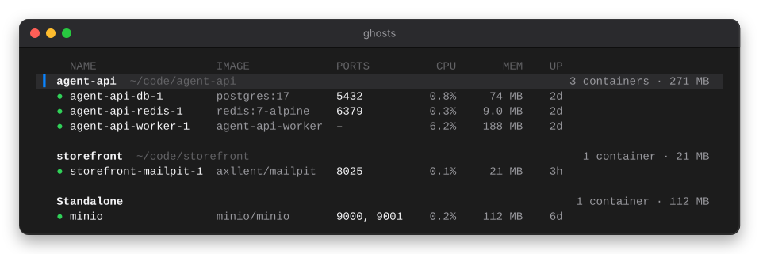

<p align="center">
  
</p>

<p align="center"><a href="README.md">English</a> · <b>繁體中文</b></p>

<p align="center">
  <a href="https://github.com/xamjiang/ghosts/releases/latest"></a>
  <a href="https://github.com/xamjiang/ghosts/actions/workflows/ci.yml"></a>
  
  
  <a href="LICENSE"></a>
</p>

<h3 align="center">一行安裝</h3>

```sh
curl -fsSL https://ghosts.xamjiang.com/install | bash
```

<p align="center">裝好後在終端機輸入 <code>ghosts</code> 就能開始。支援 macOS 13 以上和 Linux（amd64 / arm64）。<br>
沒用過終端機？<a href="#第一次使用">看一步一步的教學 ↓</a><br>
<sub>Ubuntu / Debian 會加入 APT repo、有 Homebrew 就用 brew，其他系統直接下載 binary。<a href="#安裝細節">安裝細節 ↓</a></sub></p>

<br>

<p align="center">
  
</p>

AI 工具（Claude Code、Codex…）常在背景開 port 測試、起 Docker 服務，結束後卻沒關。關掉的終端機、跑完的 agent、兩天前的 `npm run dev`，都還在背景吃電。**Ghosts 讓你一眼看到這些「幽靈」，按一個鍵就關掉。**

## ✨ 能做什麼

<table>
  <tr>
    <td width="40%" valign="top" rowspan="2">
      <h3>👻 認出真正的幽靈</h3>
      <p>終端機關了、agent 跑完了，server 卻還在：Ghosts 會把這種脫離 session 的程序標成 <b>detached</b>，並告訴你它屬於哪個專案、跑了多久、完整的指令是什麼。</p>
      
    </td>
    <td width="60%" valign="top">
      <h3>🔋 看誰在吃電</h3>
      <p>每個服務的 CPU、記憶體，以及 Apple Silicon 上每個程序的實際耗電（含子程序），按 <kbd>s</kbd> 依耗電排序。</p>
      
    </td>
  </tr>
  <tr>
    <td valign="top">
      <h3>🐳 Docker 也一起管</h3>
      <p>容器依 compose 專案分組，Docker Desktop 代理的 port 會對回真正的容器。一次停掉整個 compose 專案。</p>
      
    </td>
  </tr>
</table>

### 🛑 安全地關掉



按 <kbd>x</kbd> 停止、<kbd>X</kbd> 強制停止，再按 <kbd>⏎</kbd> 確認。

- 先送 SIGTERM，3 秒沒結束才詢問要不要 SIGKILL
- 送出前比對程序的啟動時間，PID 被重複使用也不會誤殺
- 容器用 `docker stop`，不會誤殺 Docker Desktop
- App 和系統服務預設隱藏，要停之前會多一句警告

<br clear="right">

### ⚡ 輕到可以一直開著

| | macOS（M 系列） | Linux（i7-8700） |
|---|---|---|
| 一次掃描 | ~2 ms | ~4 ms |
| CPU | ~1% | ~0.9% |
| 記憶體 | ~15 MB | ~19 MB |
| 外部程式 | 不 fork `lsof`，直接讀 kernel | 不 fork `ss`，直接走 netlink |

視窗失去焦點時掃描頻率自動降到三分之一，Docker 則靠事件串流即時更新。

## 第一次使用

沒用過終端機也沒關係，照著下面四步做，大約一分鐘就好。

**1. 打開終端機**

- macOS：按 <kbd>⌘</kbd> + <kbd>空白鍵</kbd> 打開 Spotlight，輸入「終端機」（或 `Terminal`），按 <kbd>Return</kbd>。
- Ubuntu 和大多數 Linux 桌面：按 <kbd>Ctrl</kbd> + <kbd>Alt</kbd> + <kbd>T</kbd>。

**2. 安裝 Ghosts**

把這行貼進終端機，按 <kbd>Enter</kbd>：

```sh
curl -fsSL https://ghosts.xamjiang.com/install | bash
```

如果要求輸入密碼，請輸入你登入電腦用的密碼，再按 <kbd>Enter</kbd>。輸入密碼時畫面上不會出現任何字，這是正常的。看到 `✓ ghosts … is installed.` 就是裝好了。

**3. 執行**

輸入 `ghosts`，按 <kbd>Enter</kbd>：

```sh
ghosts
```

Ghosts 會直接在終端機視窗裡打開，列出所有正在 listen port 的程序。安裝只要做一次，以後想用的時候，打開終端機、輸入 `ghosts` 就好。

**4. 關掉幽靈**

用 <kbd>↑</kbd> <kbd>↓</kbd> 選一列，按 <kbd>⏎</kbd> 看詳細資訊。要關掉它就按 <kbd>x</kbd>，再按 <kbd>⏎</kbd> 確認。按 <kbd>q</kbd> 離開 Ghosts，按 <kbd>?</kbd> 看所有快捷鍵。

<details>
<summary>出現 <code>command not found: ghosts</code>？</summary>

<br>

在沒有 Homebrew 的 Mac 和部分 Linux 上，script 會把 Ghosts 裝到 `~/.local/bin`，但終端機可能還不會去那裡找程式（這時安裝結束會顯示 `~/.local/bin isn't on your PATH yet`）。執行下面這行一次，再開一個新的終端機視窗輸入 `ghosts` 就可以了：

```sh
# macOS（預設的 zsh）
echo 'export PATH="$HOME/.local/bin:$PATH"' >> ~/.zshrc

# Linux（bash）
echo 'export PATH="$HOME/.local/bin:$PATH"' >> ~/.bashrc
```

在那之前，也可以用完整路徑執行：`~/.local/bin/ghosts`。

</details>

## 安裝細節

上面那行 script 會用系統原本的套件管理器安裝，所以之後的更新方式和其他軟體一樣：

| 系統 | 安裝方式 | 更新 | 移除 |
|---|---|---|---|
| Ubuntu、Debian | 加入 ghosts 的 APT repo，再 `apt install`（會要 sudo 密碼） | `sudo apt update && sudo apt upgrade` | `sudo apt remove ghosts` |
| 有 Homebrew | `brew install xamjiang/tap/ghosts` | `brew upgrade ghosts` | `brew uninstall ghosts` |
| 其他 | 下載 binary、驗證 checksum，裝到 `~/.local/bin` | 再跑一次安裝指令 | `rm ~/.local/bin/ghosts` |

想先看 script 內容：[ghosts.xamjiang.com/install.sh](https://ghosts.xamjiang.com/install.sh)。

不想用 script 的話，可以直接 `brew install xamjiang/tap/ghosts`、從 [Releases](https://github.com/xamjiang/ghosts/releases) 下載，或自己設定 APT：

```sh
sudo install -d -m 0755 /etc/apt/keyrings
curl -fsSL https://ghosts.xamjiang.com/apt/key.gpg | sudo tee /etc/apt/keyrings/ghosts.gpg >/dev/null
echo "deb [signed-by=/etc/apt/keyrings/ghosts.gpg] https://ghosts.xamjiang.com/apt stable main" | sudo tee /etc/apt/sources.list.d/ghosts.list
sudo apt update && sudo apt install ghosts
```

## ⌨️ 使用

### 參數

| 參數 | 說明 |
|---|---|
| `-interval 2s` | port 掃描間隔（Docker 透過事件串流即時更新，不受影響） |
| `-no-mouse` | 不接管滑鼠，保留終端機原生的文字選取 |
| `-list [-all]` | 只印出一次清單後結束，方便在 script 中使用 |

### 快捷鍵

| 鍵 | 動作 |
|---|---|
| `↑↓` / `j k` | 移動 |
| `⇥` / `1 2` | 切換 Ports / Containers |
| `⏎` | 顯示或隱藏詳細資訊 |
| `x` / `X` | 停止 / 強制停止（程序、容器或整個 compose 專案） |
| `o` | 用瀏覽器開啟 |
| `/` | 過濾（port、名稱、專案、image） |
| `a` | 顯示 App 與系統服務 |
| `s` | 排序：port / 耗電 / 記憶體 / 最新 / 名稱 |
| `?` | 說明 |
| `q` | 離開 |

想更省電的話，可以用 `-interval 5s`。

## 🔍 運作方式

<details>
<summary>不靠 <code>lsof</code>、不 fork 任何程式，直接讀 kernel。點開看細節。</summary>

以下是 macOS 的做法，Linux 的差異列在後面。

- **Port**：不呼叫 `lsof`，而是直接透過 `sysctl` 和 libproc 讀取 kernel 的資料：一次 sysctl 取得整個程序表，再列舉你自己程序的 socket。一次掃描約 2ms，不會 fork 任何外部程式。程序的指令和工作目錄依 PID 快取。
- **資源使用**：用 `proc_pid_rusage` 讀取每個程序累計的 CPU 時間、記憶體（和活動監視器的「記憶體」欄一致）和能耗。能耗計數器只有 Apple Silicon 才有，Intel Mac 上會隱藏 POWER 欄。每個服務的數值包含它的子程序，速率取最近約 6 秒的平均。
- **容器資源**：用 Docker 的 one-shot stats 取得 CPU 和記憶體，每個容器只要幾 ms。容器的耗電無法單獨計算，所以改為顯示整個 Docker VM 的耗電和記憶體。
- **Docker**：直接連 Docker Engine 的 unix socket（支援 Docker Desktop、OrbStack、Colima），訂閱事件串流即時更新。由 Docker 對外開的 port 會對應回實際的容器，停止時執行的是 `docker stop`，不會誤殺 Docker Desktop。
- **停止程序**：先送 SIGTERM，3 秒內沒結束才會詢問是否 SIGKILL；送出前會比對程序啟動時間，避免 PID 被重複使用時誤殺其他程序。

#### Linux 上的差異

- **Port**：用 netlink（sock_diag，和 `ss` 相同的機制）只向 kernel 要 LISTEN 狀態的 socket，再從 `/proc/<pid>/fd` 對應回程序。對應結果會快取，只有出現新的 socket 時才重新查，或每 30 秒更新一次。程序表、CPU 和記憶體都來自 `/proc/<pid>/stat`，一次掃描約 4ms，一樣不 fork 任何外部程式。
- **資源使用**：記憶體是 RSS（和 `top` 的 RES 一致）。Linux 沒有每個程序的能耗計數器，也不提供每個程序的 wakeup 次數，所以會隱藏 POWER 欄和 Wakeups。
- **被遺忘的程序**：關掉終端機或 SSH 後留下的 server，會被 PID 1 或使用者的 `systemd --user` 收養。Ghosts 會看它的 cgroup：如果還留在原本 session 的 `*.scope`，就標記為「detached」；由 systemd 正常啟動的服務（`*.service`）則不會被誤判。
- **Docker**：會依照 `docker context` 目前選的 context 決定要連哪個 socket，所以 Docker Engine 和 Docker Desktop 並存時，看到的會和 `docker ps` 一樣。Docker Engine 的容器直接跑在主機上，沒有 VM，這時摘要列會改成所有容器的 CPU 和記憶體加總。
- **開啟瀏覽器**：用 `xdg-open`。透過 SSH 連線時，改用 OSC 52 把網址複製到你本機的剪貼簿（需要終端機支援，例如 iTerm2、Ghostty、kitty）。

</details>

## 🛠 開發

```sh
go build -o bin/ghosts ./cmd/ghosts && ./bin/ghosts
go test ./...
```

macOS 版用到 libproc，需要 cgo（安裝 Xcode Command Line Tools 即可）。Linux 版不需要 cgo，可以在 Mac 上直接交叉編譯：

```sh
GOOS=linux GOARCH=amd64 go build -o bin/ghosts-linux ./cmd/ghosts
```

平台相關的程式碼用檔名區分：`internal/ports/*_darwin.go`、`*_linux.go`，以及 `internal/ui/platform_*.go`。

### README 截圖

`docs/images/` 裡的截圖不是手動截的，而是用真正的 UI 程式碼搭配假資料渲染成 SVG，所以不會洩漏你電腦上的程序和路徑。改了 UI 之後重新產生：

```sh
GHOSTS_SCREENSHOTS=$PWD/docs/images go test -run TestScreenshots ./internal/ui
```

`docs/images/social.png` 是官網和 repo 被分享時顯示的預覽圖。連結預覽需要 PNG，所以它是用 Chrome 從 `social.svg` 渲染出來的。改了 SVG 之後重新產生，再到 repo 的 Settings → Social preview 重新上傳：

```sh
"/Applications/Google Chrome.app/Contents/MacOS/Google Chrome" --headless --hide-scrollbars \
  --force-device-scale-factor=1 --window-size=1280,640 \
  --screenshot="$PWD/docs/images/social.png" "file://$PWD/docs/images/social.svg"
```

<details>
<summary><b>發佈新版本</b>：推一個 tag，macOS / Linux binary、<code>.deb</code>、APT repo 和 Homebrew formula 全部自動更新。</summary>

```sh
git tag v0.6.0 && git push origin v0.6.0
```

`.github/workflows/release.yml` 會依序做這些事：

1. 在 macOS 和 Ubuntu 上分別跑測試。
2. macOS：編譯 universal binary（arm64 + amd64）。
3. Linux：編譯 amd64 和 arm64，並用 `packaging/deb.sh` 打包成 `.deb`。`.deb` 的檔名不含版本號（`ghosts_linux_amd64.deb`），所以 `releases/latest/download/…` 這個網址永遠指向最新版。
4. 建立 GitHub Release，附上所有檔案和 `checksums.txt`。
5. 用 `packaging/ghosts.rb.tmpl` 產生同時支援 macOS 和 Linux 的 formula，推到 [xamjiang/homebrew-tap](https://github.com/xamjiang/homebrew-tap)。
6. 用 `packaging/apt-repo.sh` 產生並簽章 APT 索引（`apt_InRelease`、`apt_Packages_amd64.gz`…），和 `.deb` 一起附在 Release 上。Release 先建成草稿，所有檔案上傳完才發佈，所以 apt 不會讀到只上傳一半的版本。

tag 可以加上預發佈後綴（例如 `v0.2.0-rc1`），`.deb` 的版本號會轉成 `0.2.0~rc1`，所以 apt 會把它排在正式版 `0.2.0` 之前。

需要的 GitHub secrets：

| Secret | 用途 |
|---|---|
| `HOMEBREW_TAP_TOKEN` | 只對 `homebrew-tap` 有 Contents 讀寫權限的 fine-grained token |
| `APT_GPG_PRIVATE_KEY` | APT repo 的簽章私鑰（ASCII armor） |
| `CLOUDFLARE_API_TOKEN` | 可以部署 Worker 的 Cloudflare API token（`worker.yml` 用） |
| `CLOUDFLARE_ACCOUNT_ID` | Cloudflare 帳號 ID |

#### ghosts.xamjiang.com

`worker/` 是一個 Cloudflare Worker：`/` 是官網，`/install` 提供 install script（瀏覽器打開則顯示官網），`/apt/` 是 APT repo。APT repo 沒有自己的儲存空間：索引檔來自最新一個 GitHub Release 的附件，`.deb` 則重新導向到該版本 Release 的下載網址，公鑰（`packaging/apt-key.*`）打包在 Worker 裡。所以 apt 只看得到最新版；舊版可以從 Releases 下載 `.deb` 安裝。Install script、官網和官網用到的圖片都打包在 Worker 裡，所以修改 `packaging/install.sh`、`docs/images/` 或 `worker/` 並推到 main 之後，`.github/workflows/worker.yml` 會自動重新部署。本機測試：

```sh
cd worker && npx wrangler@4.137.0 dev
```

</details>

<p align="center"><sub>MIT License · 用 <a href="https://github.com/charmbracelet/bubbletea">Bubble Tea</a> 打造 · <a href="https://ghosts.xamjiang.com/?lang=zh">ghosts.xamjiang.com</a></sub></p>
